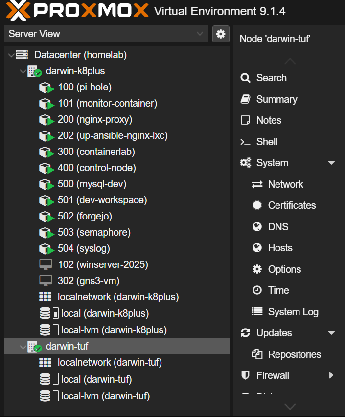
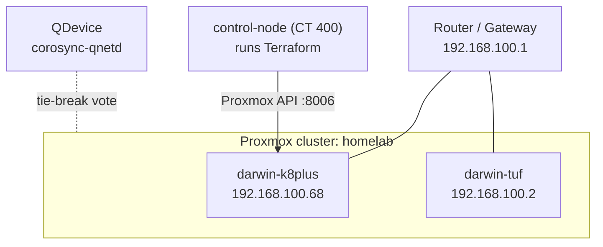
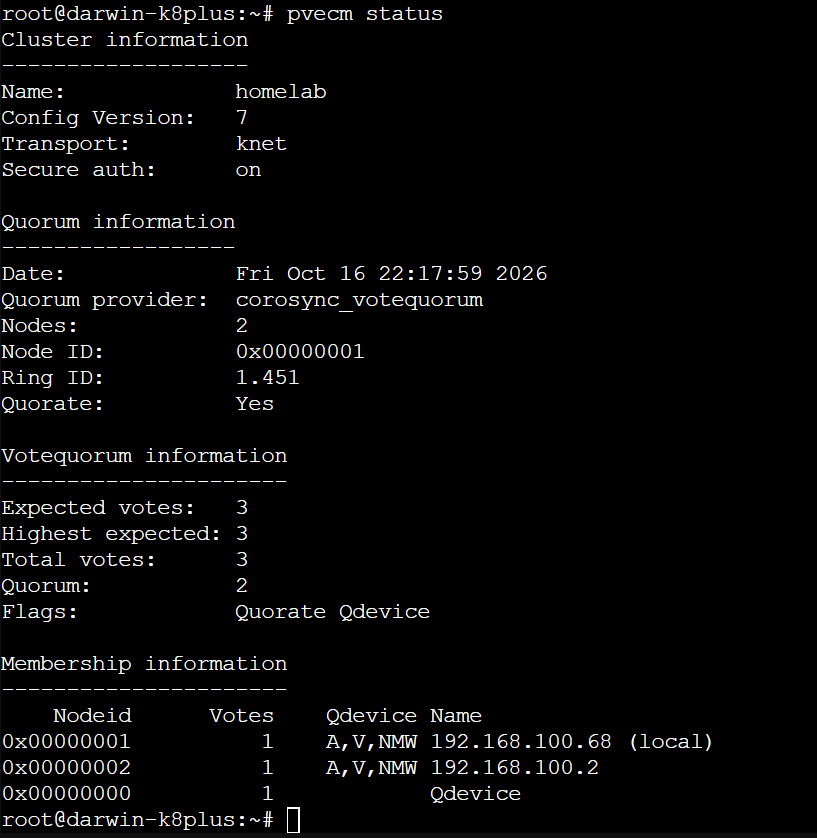
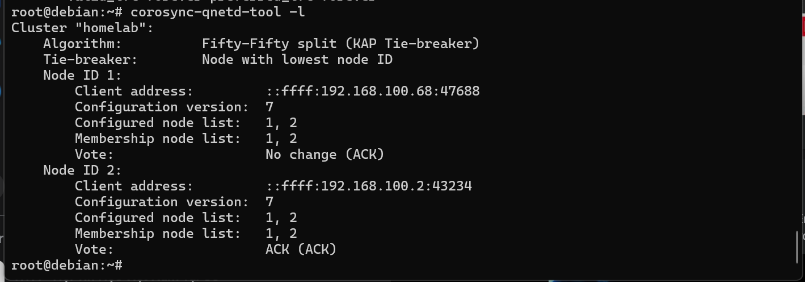

# homelab-terraform

Terraform code I use to provision Debian LXC containers on my Proxmox VE homelab, using the [bpg/proxmox](https://registry.terraform.io/providers/bpg/proxmox/latest) provider.

Each container is one entry in a map in `terraform.tfvars`. A single reusable module turns each entry into a container. To add a new container I add a few lines of data. I don't write a new resource block.



---

## Contents

- [The lab](#the-lab)
- [What this repo manages](#what-this-repo-manages)
- [Repository layout](#repository-layout)
- [How it works](#how-it-works)
- [Usage](#usage)
- [Module reference](#module-reference)
- [Security notes](#security-notes)
- [Known limitations](#known-limitations)

---

## The lab

| Item | Detail |
|---|---|
| Hypervisor | Proxmox VE 9.1 |
| Cluster | `homelab`: 2 nodes (`darwin-k8plus`, `darwin-tuf`) plus an external QDevice |
| Terraform target node | `darwin-k8plus` (GMKtec K8 Plus) at `192.168.100.68` |
| Network | `192.168.100.0/24` on bridge `vmbr0` |
| Gateway | `192.168.100.1` (home router) |
| DHCP pool | `.10` to `.49`. Servers and containers use static IPs from `.50` up |
| DNS | Pi-hole container at `192.168.100.111`, handed out by the router's DHCP |



### Why there's a QDevice

A 2-node cluster loses quorum as soon as one node goes down. The QDevice adds a third vote, so the cluster stays quorate (3 expected votes, quorum = 2) when either node is offline.

<details>
<summary>Cluster and QDevice status</summary>





</details>

---

## What this repo manages

These five containers were created with this repo and are tracked in Terraform state:

| CT ID | Hostname | Intended role | IP |
|---|---|---|---|
| 500 | `mysql-dev` | Database for development | `192.168.100.50/24` |
| 501 | `dev-workspace` | Clean coding environment | `192.168.100.51/24` |
| 502 | `forgejo` | Self-hosted Git | `192.168.100.52/24` |
| 503 | `semaphore` | Ansible Semaphore (provisioned, not configured yet) | `192.168.100.53/24` |
| 504 | `syslog` | Central log collection | `192.168.100.54/24` |

The CT ID matches the last octet of each IP (500 → `.50`, 501 → `.51` and so on), so I can tell which container an address belongs to at a glance.

The other guests on the node (`pi-hole`, `monitor-container`, `nginx-proxy`, `containerlab`, `control-node`, and the `winserver-2025` and `gns3-vm` VMs) were built by hand before this project. **Terraform does not manage them.**

---

## Repository layout

```
homelab-terraform/
├── providers.tf          # Provider version and how to connect to the Proxmox API
├── variables.tf          # Root inputs: credentials and the lxc_containers map
├── main.tf               # Calls the module once per map entry (for_each)
├── outputs.tf            # Prints hostname → IP after apply
├── terraform.tfvars      # Real values, gitignored (see example below)
├── .terraform.lock.hcl   # Locked provider version (bpg/proxmox 0.100.0)
└── modules/
    └── proxmox-lxc/
        ├── main.tf       # The proxmox_virtual_environment_container resource
        ├── variables.tf  # Module inputs, with lab-specific defaults
        └── outputs.tf    # container_ip
```

---

## How it works

```
terraform.tfvars          lxc_containers = { "mysql-dev" = { vm_id = 500, ... }, ... }
        │
        ▼
main.tf (root)            for_each = var.lxc_containers
                          each.key   → hostname
                          each.value → vm_id, cores, memory, disk, IP, password
        │
        ▼
modules/proxmox-lxc       one proxmox_virtual_environment_container per entry
        │
        ▼
Proxmox API               creates CT 500 "mysql-dev" on darwin-k8plus
```

- **The map key is the hostname.** `"mysql-dev" = { ... }` creates a container named `mysql-dev`.
- **Anything not set in tfvars falls back to the module defaults.** These are node `darwin-k8plus`, storage `local-lvm`, bridge `vmbr0`, gateway `192.168.100.1` and the Debian 12 template.
- **Every container uses the same module.** A fix made in the module applies to all containers on the next `apply`.

---

## Usage

### Prerequisites

- Terraform installed on the machine you run it from (I use my `control-node` container).
- Network access to the Proxmox API at `https://192.168.100.68:8006`.
- The Debian 12 LXC template downloaded to the node's `local` storage:

  ```bash
  pveam update
  pveam download local debian-12-standard_12.12-1_amd64.tar.zst
  ```

### 1. Create `terraform.tfvars`

This file is gitignored because it holds passwords. Example:

```hcl
proxmox_rootuser = "root@pam"
proxmox_password = "change-me"

lxc_containers = {
  "mysql-dev" = {
    vm_id                   = 500
    identity_description    = "MySQL database for development."
    cpu_cores               = 2
    memory_dedicated        = 1024   # MB
    disk_size               = 8      # GB
    network_ip_address      = "192.168.100.50/24"
    initialization_hostname = "mysql-dev"
    initialization_password = "change-me"
  }

  "dev-workspace" = {
    vm_id                   = 501
    identity_description    = "Clean coding environment."
    cpu_cores               = 2
    memory_dedicated        = 512
    disk_size               = 5
    network_ip_address      = "192.168.100.51/24"
    initialization_hostname = "dev-workspace"
    initialization_password = "change-me"
  }
}
```

> `network_ip_address` needs the CIDR suffix (`/24`). Pick an IP outside the DHCP pool (`.10` to `.49`) that isn't already in use.

### 2. Run it

```bash
terraform init      # download the bpg/proxmox provider
terraform fmt       # tidy formatting
terraform validate  # catch syntax and type errors
terraform plan      # preview what will change
terraform apply     # create or update the containers
```

After `apply`, the output shows each container's IP:

```
container_ips = {
  "dev-workspace" = "192.168.100.51/24"
  "mysql-dev"     = "192.168.100.50/24"
  ...
}
```

### Add a container

Add one more entry to `lxc_containers`, then run `terraform plan` and `terraform apply`. The plan should show `1 to add, 0 to change, 0 to destroy`. If it shows anything else, stop and read it before applying.

### Remove a container

Delete its entry from the map and run `terraform apply`. Terraform destroys **only** that container. To remove everything this repo manages, run `terraform destroy`. Hand-built guests are not in state, so they are never touched.

---

## Module reference

`modules/proxmox-lxc` inputs:

| Variable | Type | Default | Description |
|---|---|---|---|
| `vm_id` | number | (required) | Container ID |
| `initialization_hostname` | string | (required) | Hostname (set from the map key) |
| `initialization_password` | string, sensitive | (required) | Root password inside the container |
| `network_ip_address` | string | (required) | IP in CIDR, e.g. `192.168.100.50/24` |
| `identity_description` | string | `"Debian LXC."` | Notes shown in Proxmox |
| `node_name` | string | `"darwin-k8plus"` | Target Proxmox node |
| `cpu_cores` | number | `2` | vCPU cores |
| `memory_dedicated` | number | `512` | RAM in MB |
| `disk_size` | number | `5` | Root disk in GB |
| `disk_datastore_id` | string | `"local-lvm"` | Storage for the root disk |
| `network_interface` | string | `"eth0"` | Interface name inside the container |
| `network_bridge` | string | `"vmbr0"` | Proxmox bridge to attach to |
| `network_gateway` | string | `"192.168.100.1"` | Default gateway |
| `os_template` | string | `"local:vztmpl/debian-12-standard_12.12-1_amd64.tar.zst"` | LXC template |
| `start_on_boot` | bool | `true` | Start the container when the node boots |

Output: `container_ip`, the IP address passed in.

---

## Security notes

- **`terraform.tfvars` and `*.tfstate` are gitignored.** Both contain passwords in plain text. State is stored locally on the control node and is never committed.
- **Credentials are marked `sensitive`**, so Terraform hides them in `plan` and `apply` output.
- **`insecure = true`** skips TLS verification because the Proxmox node uses its default self-signed certificate. That's acceptable on my home LAN, but it shouldn't be copied into anything exposed.

---

## Known limitations

These are the shortcuts I took to get the lab working, kept here so they're visible:

- Authentication uses the **root username and password**. A dedicated Proxmox user with an **API token** limited to the needed permissions would be better.
- The **API endpoint is hard-coded** in `providers.tf` rather than set by a variable.
- **State is local.** If the control node is lost, the state file is lost with it.
- Containers are created with a **root password only**. No SSH key is injected.
- Terraform only creates the containers. **Software inside them is installed by hand.**
- Everything targets **one node** (`darwin-k8plus`). The module supports other nodes through `node_name`, but I haven't used it on `darwin-tuf`.
